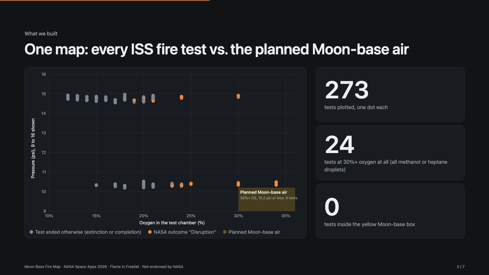
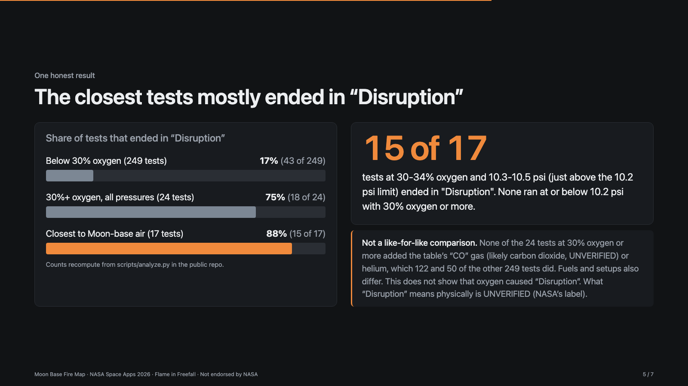

# Moon Base Fire Map (NASA Space Apps 2026, Flame in Freefall)
Static page: `index.html` (chart), `slides/index.html` (7 slides incl. title). Data: NASA PSI FLEX (PSI-69), CC0-1.0, DOI 10.60555/mbq8-0451, fetched 2026-11-14. Analysis code is in the full project folder (`scripts/analyze.py`). Licence: Apache-2.0. Not endorsed by NASA.
AI use: Claude (an AI assistant) wrote most of the code, the page and the slides, and ran the data checks. AI helpers also researched ideas and judging rules. I chose the idea, directed the work and reviewed the results.

## Slide images

All 7 slides: images/slide-1.png to images/slide-7.png (screenshots of slides/index.html).
